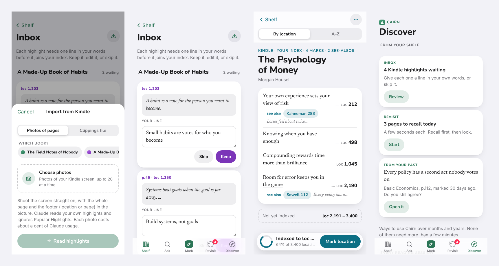
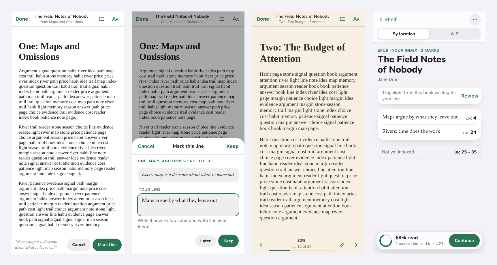

# Cairn

A personal index for the books you read: on paper, on Kindle, or as EPUBs read right in the app. When a page matters, write its number and one line in your own words. Link ideas across books and say why they're alike. Later, ask a question and Cairn walks your shelf and points to the book and the page. Installable on phone and laptop, works offline, syncs between devices.

Same family as margin and recall.






## Stack
- **Next.js 15 on Vercel**, used only for a few API routes. The app itself is a plain page in `public/` (no React, no build step for the UI). Same setup as margin and recall.
- **Supabase**: Postgres plus Auth and Storage. Shares margin's project and login, like recall. Cairn's tables (`cairn_books`, `cairn_marks`, `cairn_links`) and its private `cairn-books` storage bucket don't touch margin's or recall's.
- **EPUB reader**: [epub.js](https://github.com/futurepress/epub.js) 0.3.93 with JSZip 3.10.1, pinned in `public/vendor/`. Books render in a sandboxed frame with scripts off.
- **Claude**: called from `app/api/suggest`, `app/api/ask`, `app/api/kindle` and `app/api/draft`. The key stays on the server and only `ALLOWED_EMAIL` can use it.
- **Offline**: a service worker caches the app; your shelf lives in local storage and syncs when you're back online.

## Project layout
```
app/api/suggest/route.js  POST /api/suggest: a new mark → up to 3 marks that might be "like" it (owner only)
app/api/ask/route.js      POST /api/ask: a question + your marks → the marks that answer it, a short answer, and what's missing (owner only)
app/api/kindle/route.js   POST /api/kindle: up to 4 photos of a Kindle screen → your highlights, their location or page, and a drafted line (owner only)
app/api/draft/route.js    POST /api/draft: imported highlights → a drafted one-line note for each, which you edit (owner only)
app/api/config/route.js   served as /config.js: hands the browser the public Supabase URL and key
lib/server.js             who is calling, and the call to Claude (same as recall's)
public/index.html         markup
public/styles.css         styles (tokens at the top; dark mode redefines them)
public/app.js             all app logic, split into commented sections
public/sw.js              offline cache (bump CACHE to force-refresh every device)
public/vendor/supabase.js pinned Supabase client (2.118.0, same file as recall)
public/vendor/epub.min.js pinned epub.js (0.3.93, BSD-2-Clause) for the reader
public/vendor/jszip.min.js pinned JSZip (3.10.1, MIT), which epub.js uses to open .epub files
supabase/schema.sql       tables, row-level security
design/                   the four directions explored first
docs/screens/             screenshots
```

## Setup (about 10 minutes)

1. **Supabase** (margin's project): SQL Editor → New query → paste `supabase/schema.sql` → Run. Safe to run again after updates. Nothing else to change: you sign in with your margin account.
   - **Ran it before?** Run the whole file again after each update (it adds the Kindle columns, the EPUB columns and the `cairn-books` storage bucket with its policies). Until you do, Cairn keeps your shelf on this device and the sync status says *Run supabase/schema.sql*.
2. **Local**
   ```bash
   git clone https://github.com/ajushibu/cairn.git
   cd cairn
   npm install
   cp .env.local.example .env.local   # same four values as recall's .env.local
   npm run dev                        # http://localhost:3000
   ```
   Sign in from the banner on the shelf (or **⋯ → Sign in**) with your margin email and password.
3. **Deploy**: Vercel → Add New → Project → import `cairn` (framework: Next.js, nothing to change). Add the env vars below, then deploy.
4. **Install**: open the Vercel URL. iPhone or iPad: Safari → Share → **Add to Home Screen**. Laptop: Chrome or Edge → install icon in the address bar (or **⋯ → Install Cairn**).

## Working on it
- Edit files in `public/`, refresh `localhost:3000`. No build step for the UI.
- Ship it:
  ```bash
  git add -A && git commit -m "what changed" && git push
  ```
  Vercel deploys every push to `main` automatically, usually in under a minute.
- `npm run build` before pushing if you've touched anything in `app/` or `lib/`.
- If a device seems stuck on an old version, bump `CACHE` in `public/sw.js`.
- Backups: **⋯ → Export backup** (JSON) or **Export index as Markdown**.

## Environment variables
| Name | What |
|---|---|
| `SUPABASE_URL` | Project URL (same as margin and recall) |
| `SUPABASE_PUBLISHABLE_KEY` | Publishable (or legacy anon) key. Safe to expose; RLS does the locking. |
| `ANTHROPIC_API_KEY` | Claude API key. Server only. |
| `ALLOWED_EMAIL` | The only account allowed to use Claude in Cairn. |
| `CLAUDE_MODEL` | Optional. Answers Look deeper and reads Kindle photos. Defaults to `claude-sonnet-5-5`. |
| `CLAUDE_QUICK_MODEL` | Optional. Suggests matches for links and drafts lines for imported highlights. Defaults to `claude-haiku-5-5`. |
| `CLAUDE_EFFORT` | Optional. `low` (default), `medium`, `high` or `off`. |

## How it works
- **Mark**: page number plus one line in your own words. Enter moves from the page to the line; Enter again saves. Tap Mark in the tab bar from anywhere, or **Mark page** inside a book.
- **Index**: each book reads like a back-of-book index, with dot leaders and page numbers, sorted by page or A–Z. If you give the book's total pages, the bottom bar shows how far your index reaches and the index shows the part you haven't covered.
- **Link** ("this is like that"): connect two marks, usually across books. **Connect** stays off until you write the *because* line yourself. *Suggest matches* has Claude point at likely marks, but it never writes the reason. Links show as *see also* lines.
- **Ask**: a word search across your marks and your *because* lines, run in the browser, so it works offline and costs nothing. It walks the shelf book by book (*not that one… that book*), then shows the page in large type and the see-also trail from there.
- **Look deeper**: sends your question and your marks to Claude, which matches ideas instead of words, cites your marks, and says what your notes don't cover. Only your own notes go in; Claude is told not to add outside knowledge.
- **Revisit**: shows a book and a page number or location; you recall what you marked there before you look. Pass → 3 days → 7 → growing; miss → tomorrow.
- **Discover** (tab): nudges worked out from your shelf (highlights waiting in the inbox, pages due, a book with no links yet, a book you stopped indexing, an idea many marks connect to, and one old mark a day to look at again), then ideas for using Cairn over the long run: every reading session, every week, when you finish a book, thinking with your shelf, beyond reading alone, and over the years.
- **Deleting**: tap Delete twice, as in margin. Deleting a book deletes its marks and their links. Deletes sync as soft deletes.
- **Sync**: the same scheme as recall. Each row carries `updated_at`; changes go up in batches, and each device pulls rows newer than the last `server_ts` it saw. If a device holds a different account's shelf, it asks before replacing it.

## Marking while you read
The quickest way to capture is the moment something matters, with your phone beside the book:
- **⋯ → Open Cairn on → Mark a page.** Opening the app goes straight to the mark sheet (also when you come back to it after 5 minutes away), with the book you last marked already picked.
- **Your last spot is filled in.** The page or location box starts at your last mark in that book, cursor at the end, so you usually change only the last digits. Enter jumps to the line; Enter again saves.
- **Shortcut:** on Android and in the installed desktop app (Chrome or Edge), the app icon has a *Mark a page* shortcut (long-press or right-click). iPhone and iPad don't offer shortcuts for web apps, so use the setting above.

## Reading EPUBs in Cairn
Open a DRM-free EPUB and read it inside Cairn, marking lines as you go. **Import → EPUB book** (the ↓ button on the shelf), or **⋯ → Open an EPUB**.

- **Opening a book**: Cairn reads the title and author from the file and adds the book to your shelf. EPUB tiles open straight into the reader; **Done** takes you to the book's index. Cairn checks for DRM and says so if a book is locked: books from the Kindle, Apple Books and Google Play stores usually are. Standard Ebooks, Project Gutenberg, Humble Bundle and many indie publishers offer DRM-free EPUBs.
- **Where the file lives**: on the device that opened it (in the browser's IndexedDB), and, once you're signed in, in a private Supabase Storage bucket at `<your user id>/<book id>.epub`, readable only by you. Another signed-in device downloads it the first time it opens the book. Files over 50 MB (the free plan's limit per file) stay on the device that opened them.
- **Reading**: swipe, tap the left or right edge, or use the arrow keys to turn pages. Wide screens show two pages side by side. **Contents** (list button) jumps to a chapter; **Aa** sets text size (70–200%), theme (Auto, Light, Sepia, Dark) and font (Serif or Sans). Your place is saved as you read and syncs, so another device opens on the same page.
- **Marking**: select a line and tap **Mark this**. Cairn keeps the quote, the chapter and the exact spot; you write your line and tap **Keep**, or tap **Later** to send it to the Inbox. The pencil button marks the page you're on without selecting anything. Marks show in the text as highlights, in the book's colour (orange while they wait in the Inbox); tap one to open it.
- **Positions**: EPUBs have no fixed page numbers, so Cairn numbers them by location (about 1,000 characters each, counted once per book on each device). The index, Ask and Revisit show the location; a mark's **Open in book** opens the reader at that exact line.

## Kindle
Books can be **Paper** or **Kindle** (set it when you add or edit a book). Kindle books are numbered by location, plus the page when the book has real page numbers; the index, Revisit and Ask show whichever the book uses. Mark a Kindle spot by hand with the Location / Page switch, or import highlights. **Import** is the ↓ button on the shelf, or **⋯ → Import from Kindle**.

- **Clippings file** (whole books, free, exact): connect the Kindle e-reader to your computer with its USB cable, open the **Kindle** drive → `documents` → `My Clippings.txt`, and choose that file. It's read on your device with no AI. Cairn lists the books in it with how many highlights are new; tick the ones you want. Highlights you later extended are merged, your Kindle notes are attached to the highlight they belong to and become its line, and importing the same file again only adds what's new. The notebook export from the Kindle app (an `.html` file it emails you) works too. English-language Kindles only for now.
- **Photos of pages** (a few pages, uses Claude): photograph the e-reader screen straight on, with the footer showing. Pick the book (or make a new one) and choose up to 20 photos. They're shrunk on your phone and sent four at a time; Claude copies out your own highlights (it ignores Popular Highlights, the dotted ones), reads the location or page from the footer, and drafts a line for each.
- **Inbox**: imported highlights land here, not in your index. Each card shows the quote and a line: your Kindle note, Claude's draft (tagged *Claude's draft. Make it yours.* until you change it), or empty. **Draft lines** has Claude fill in up to 25 empty ones at a time. **Keep** moves a highlight into the book's index; **Skip** drops it (with Undo). The quote stays with the mark and shows in the mark sheet, Ask and Revisit, and in the Markdown export.

## Cost
Reading EPUBs and marking them costs nothing; book files use Supabase Storage (1 GB on the free plan, so a few hundred typical EPUBs). Suggest matches, Look deeper, Draft lines and reading photos are all buttons, so nothing is sent or billed unless you tap one. The clippings file costs nothing. Look deeper sends every mark: 300 marks is roughly 8,000 tokens in and a few hundred out, which is about 2–3 US cents at Sonnet-class prices of about $3 / $15 per million tokens. Suggest matches and Draft lines use the smaller Haiku model and cost less. A photo is shrunk to about 1,500 × 1,100 pixels before it's sent, roughly 1,600 tokens, so reading one costs on the order of half a cent to a cent. Check Anthropic's pricing page for current numbers. Supabase and Vercel free tiers cover the rest.

## Design
- Follows margin and recall: grouped background, white cards, rounded heavy titles (SF Pro Rounded, falling back to Nunito), serif for your own words (New York, falling back to Newsreader), pill buttons, glass bars, a phone tab bar, colour tiles. Book colours reuse margin's palette (indigo, ocean, lagoon, grape, dusk) plus three of Cairn's own: moss, ember and stone. Moss is Cairn's accent.
- Cairn's own parts: dot leaders and page numbers like a printed index, *see also* links, and the shelf walk in Ask.
- The four directions in `design/` were drawn before the margin and recall look was applied. They used MarginNote and Recall AI as references by mistake. Direction A, the index, was picked.


