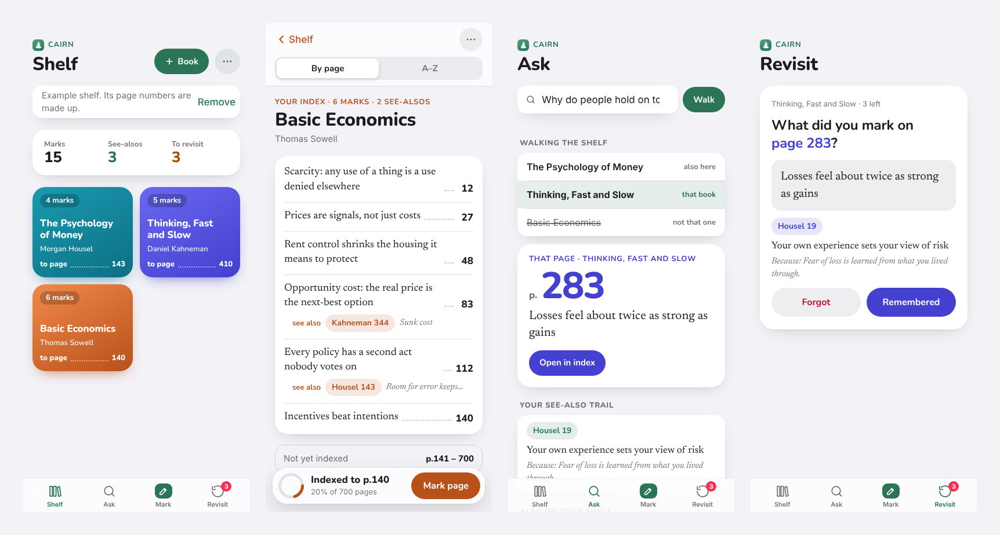
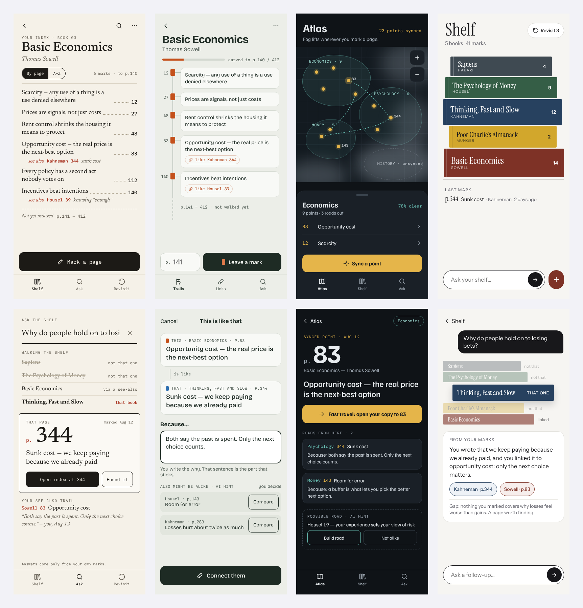

# Cairn

A personal index for the paper books you read. When a page matters, write its number and one line in your own words. Link ideas across books and say why they're alike. Later, ask a question and Cairn walks your shelf and points to the book and the page. Installable on phone and laptop, works offline, syncs between devices.

Same family as margin and recall.



## Stack
- **Next.js 15 on Vercel**, used only for three API routes. The app itself is a plain page in `public/` (no React, no build step for the UI). Same setup as margin and recall.
- **Supabase**: Postgres plus Auth. Shares margin's project and login, like recall. Cairn's tables (`cairn_books`, `cairn_marks`, `cairn_links`) don't touch margin's or recall's.
- **Claude**: called from `app/api/suggest` and `app/api/ask`. The key stays on the server and only `ALLOWED_EMAIL` can use it.
- **Offline**: a service worker caches the app; your shelf lives in local storage and syncs when you're back online.

## Project layout
```
app/api/suggest/route.js  POST /api/suggest: a new mark → up to 3 marks that might be "like" it (owner only)
app/api/ask/route.js      POST /api/ask: a question + your marks → the marks that answer it, a short answer, and what's missing (owner only)
app/api/config/route.js   served as /config.js: hands the browser the public Supabase URL and key
lib/server.js             who is calling, and the call to Claude (same as recall's)
public/index.html         markup
public/styles.css         styles (tokens at the top; dark mode redefines them)
public/app.js             all app logic, split into commented sections
public/sw.js              offline cache (bump CACHE to force-refresh every device)
public/vendor/supabase.js pinned Supabase client (2.118.0, same file as recall)
supabase/schema.sql       tables, row-level security
design/                   the four directions explored first
docs/screens/             screenshots
```

## Setup (about 10 minutes)

1. **Supabase** (margin's project): SQL Editor → New query → paste `supabase/schema.sql` → Run. Safe to run again after updates. Nothing else to change: you sign in with your margin account.
2. **Local**
   ```bash
   git clone https://github.com/ajushibu/cairn.git
   cd cairn
   npm install
   cp .env.local.example .env.local   # same four values as recall's .env.local
   npm run dev                        # http://localhost:3000
   ```
   Sign in from the banner on the shelf (or **⋯ → Sign in**) with your margin email and password.
3. **Deploy**: Vercel → Add New → Project → import `cairn` (framework: Next.js, nothing to change). Add the env vars below, then deploy.
4. **Install**: open the Vercel URL. iPhone or iPad: Safari → Share → **Add to Home Screen**. Laptop: Chrome or Edge → install icon in the address bar (or **⋯ → Install Cairn**).

## Working on it
- Edit files in `public/`, refresh `localhost:3000`. No build step for the UI.
- Ship it:
  ```bash
  git add -A && git commit -m "what changed" && git push
  ```
  Vercel deploys every push to `main` automatically, usually in under a minute.
- `npm run build` before pushing if you've touched anything in `app/` or `lib/`.
- If a device seems stuck on an old version, bump `CACHE` in `public/sw.js`.
- Backups: **⋯ → Export backup** (JSON) or **Export index as Markdown**.

## Environment variables
| Name | What |
|---|---|
| `SUPABASE_URL` | Project URL (same as margin and recall) |
| `SUPABASE_PUBLISHABLE_KEY` | Publishable (or legacy anon) key. Safe to expose; RLS does the locking. |
| `ANTHROPIC_API_KEY` | Claude API key. Server only. |
| `ALLOWED_EMAIL` | The only account allowed to use Claude in Cairn. |
| `CLAUDE_MODEL` | Optional. Answers Look deeper. Defaults to `claude-sonnet-5-5`. |
| `CLAUDE_QUICK_MODEL` | Optional. Suggests matches for links. Defaults to `claude-haiku-5-5`. |
| `CLAUDE_EFFORT` | Optional. `low` (default), `medium`, `high` or `off`. |

## How it works
- **Mark**: page number plus one line in your own words. Enter moves from the page to the line; Enter again saves. Tap Mark in the tab bar from anywhere, or **Mark page** inside a book.
- **Index**: each book reads like a back-of-book index, with dot leaders and page numbers, sorted by page or A–Z. If you give the book's total pages, the bottom bar shows how far your index reaches and the index shows the part you haven't covered.
- **Link** ("this is like that"): connect two marks, usually across books. **Connect** stays off until you write the *because* line yourself. *Suggest matches* has Claude point at likely marks, but it never writes the reason. Links show as *see also* lines.
- **Ask**: a word search across your marks and your *because* lines, run in the browser, so it works offline and costs nothing. It walks the shelf book by book (*not that one… that book*), then shows the page in large type and the see-also trail from there.
- **Look deeper**: sends your question and your marks to Claude, which matches ideas instead of words, cites your marks, and says what your notes don't cover. Only your own notes go in; Claude is told not to add outside knowledge.
- **Revisit**: shows a book and a page number; you recall what you marked there before you look. Pass → 3 days → 7 → growing; miss → tomorrow.
- **Deleting**: tap Delete twice, as in margin. Deleting a book deletes its marks and their links. Deletes sync as soft deletes.
- **Sync**: the same scheme as recall. Each row carries `updated_at`; changes go up in batches, and each device pulls rows newer than the last `server_ts` it saw. If a device holds a different account's shelf, it asks before replacing it.

## Cost
Suggest matches and Look deeper are buttons, so nothing is sent or billed unless you tap one. Look deeper sends every mark: 300 marks is roughly 8,000 tokens in and a few hundred out, which is about 2–3 US cents at Sonnet-class prices of about $3 / $15 per million tokens. Suggest matches uses the smaller Haiku model and costs less. Check Anthropic's pricing page for current numbers. Supabase and Vercel free tiers cover the rest.

## Design
- Follows margin and recall: grouped background, white cards, rounded heavy titles (SF Pro Rounded, falling back to Nunito), serif for your own words (New York, falling back to Newsreader), pill buttons, glass bars, a phone tab bar, colour tiles. Book colours reuse margin's palette (indigo, ocean, lagoon, grape, dusk) plus three of Cairn's own: moss, ember and stone. Moss is Cairn's accent.
- Cairn's own parts: dot leaders and page numbers like a printed index, *see also* links, and the shelf walk in Ask.
- The four directions in `design/` were drawn before the margin and recall look was applied. They used MarginNote and Recall AI as references by mistake. Direction A, the index, was picked.


